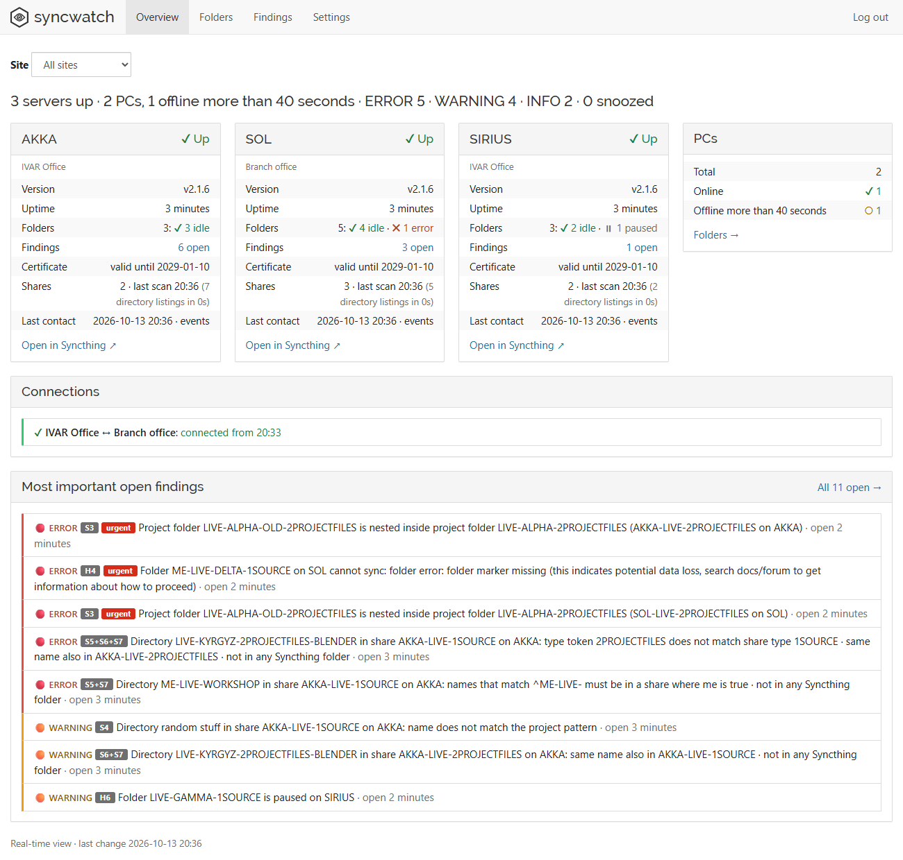
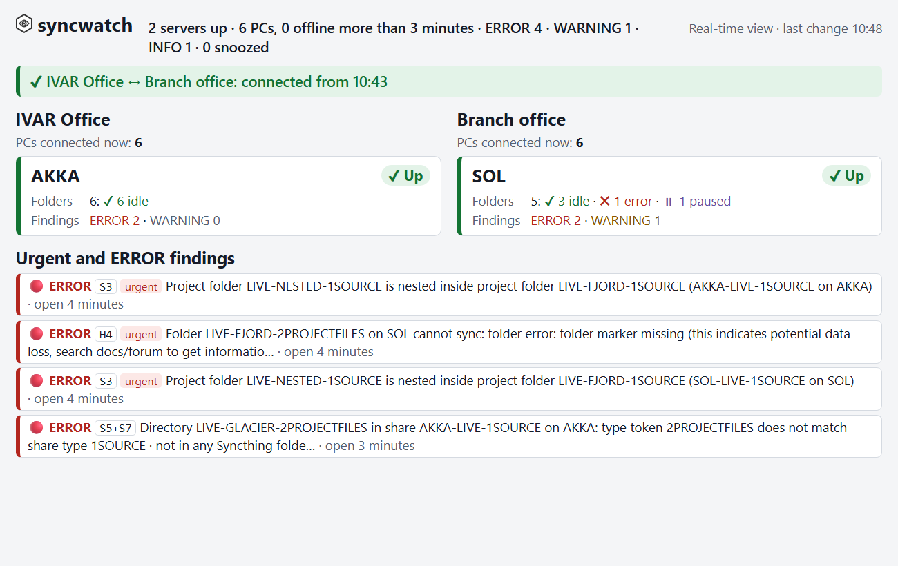

# syncwatch

[](https://github.com/ivarstudios/syncwatch/actions/workflows/ci.yml)

syncwatch is a small **read-only** monitor for [Syncthing](https://syncthing.net). IVAR Studios made it for installations with some servers (NAS hardware, on at all times) and many PCs. syncwatch gives you:

- a **dashboard** with server tiles, a grid of folders and devices and a Findings page. The dashboard is usable on a phone and refreshes automatically.
- a **weekly report** in Discord.
- **urgent messages** in Discord for large faults. Examples: a server unreachable, servers not connected, a folder that stopped the sync, a nested project folder.
- a **lobby page** for a screen in the office, and a **JSON API** for Home Assistant and scripts.

syncwatch **never changes Syncthing**. It reads the REST API of each server with a typed client. The client can only send `GET` requests to an allowlist of endpoints. Thus syncwatch needs no SMB mounts, no file system access and no software on the PCs. Only the optional folder sizes on the Folders page need the [read-only gate](#read-only-gate) on the NAS, with the shares mounted read-only.



More screenshots: [Folders](docs/screenshots/grid.png) · [Findings](docs/screenshots/problems.png) · [Lobby page](docs/screenshots/lobby.png).

**Status:** test release. The latest test release is [`v0.9.0-rc5`](https://github.com/ivarstudios/syncwatch/releases/tag/v0.9.0-rc5), a pre-release (image tag `0.9.0-rc5`). The image is public on GHCR: a pull needs no login. Since 2026-10-14 the test runs on 3 QNAP NAS (QTS and QuTS hero): syncwatch on one of them, and a read-only gate on each. The examples below name version 1.0.0, which follows after this test. Until then, use the latest `0.9.0-rc…` image or [build syncwatch yourself](#build-it-yourself). syncwatch supports Syncthing 2.x only.

## Contents

- [Install](#install) · [Health check](#health-check-and-dead-man-url) · [Environment variables](#environment-variables) · [First start](#first-start) · [Configuration](#configuration) · [Sites](#sites)
- [Checks](#checks) · [Notifications](#notifications) · [Lobby page](#lobby-page) · [Security](#security) · [JSON status API](#json-status-api) · [Home Assistant](#home-assistant)
- [Server probe](#server-probe) · [Development](#development) · [Limitations](#known-limitations)

## Install

The Docker image `ghcr.io/ivarstudios/syncwatch` is available for `linux/amd64` and `linux/arm64`.

```yaml
services:
  syncwatch:
    image: ghcr.io/ivarstudios/syncwatch:1.0.0   # also use the digest, see Updates
    container_name: syncwatch
    restart: unless-stopped
    user: "65532:65532"          # the user of the image. It must own ./data
    read_only: true
    tmpfs: [/tmp]
    cap_drop: [ALL]
    security_opt: ["no-new-privileges:true"]
    environment:
      - TZ=Europe/Stockholm
      - SYNCWATCH_TLS_HOSTS=192.168.1.10   # the address that you open: for the certificate and the Host check
    ports:
      - "192.168.1.10:8386:8386"  # LAN address only
    volumes:
      - ./data:/data
```

Caution: keep `data` private. `secret.key` in it decrypts the stored API keys.

```sh
mkdir data && sudo chown 65532:65532 data && chmod 700 data   # the same user as the user: line
docker compose up -d
docker logs syncwatch                       # shows the setup token
```

The image runs as the non-root user 65532 with a read-only root file system. A named volume gets the owner 65532 from the image. A bind mount works with any user ID that owns the directory: use that ID in the `user:` line. If the user cannot write to `/data`, syncwatch stops at the start with "permission denied" in the log.

The image writes only to `/data`: an SQLite database, `secret.key` and, with self-signed HTTPS, its certificate. The image makes `/data` with mode 0700. A bind mount keeps the mode of the host directory. syncwatch sets the database files to mode 0600 at each start. Make a backup of `/data` (see [Backup and restore](#backup-and-restore)).

If you lose `secret.key`, or change `SYNCWATCH_SECRET_KEY`, syncwatch cannot decrypt the stored API keys and the webhooks. The dashboard then shows an H1 finding for each server with the reason that the API key is not readable. The notification banner reports that the webhook is not readable. Settings shows the API keys and the webhooks as set, but not readable. Type the API keys and the webhooks again, or restore the old secret key. The API tokens continue to work, because syncwatch keeps only their hash.

The log reports the secret key at the start. If syncwatch makes a new `secret.key` while the database contains secrets, the log shows an error: the old secret key is missing or replaced. If `SYNCWATCH_SECRET_KEY` is set and `/data/secret.key` also exists, the log shows a warning, because syncwatch uses only the variable. If the secret key cannot decrypt the stored secrets, the log also shows an error at the start.

The binary `syncwatch` also runs without Docker, also on Windows: `syncwatch serve --data ./data`. See the [releases](https://github.com/ivarstudios/syncwatch/releases). The binary listens on `127.0.0.1:8386`. To listen on a LAN address, give `--listen 192.168.1.10:8386` or set `SYNCWATCH_LISTEN`. The image listens on `:8386` in the container. Thus the address in `ports:` decides who can reach the dashboard. Always give that address: a `-p 8386:8386` without an address opens the port on each interface of the host. Port 8386 is next to the Syncthing GUI (8384) and the gate (8385). syncwatch does not use port 8080, because a QNAP NAS uses that port for its administration page.

The data directory is `--data` or `SYNCWATCH_DATA`. The default is `/data` if that directory exists, or `./data` in the current directory. The start log shows the resolved path.

Caution: do not connect syncwatch to the internet. Use the LAN, a VPN or a reverse proxy with its own authentication.

### Build it yourself

```sh
git clone https://github.com/ivarstudios/syncwatch && cd syncwatch
docker build -t syncwatch:dev .                 # the image: write image: syncwatch:dev above
go build -o syncwatch ./cmd/syncwatch           # or the binary (Go 1.27.2 or later)
```

The image builds for `linux/amd64` and `linux/arm64` (`docker buildx build --platform …`). The binary cross-compiles with `GOOS`, `GOARCH` and `CGO_ENABLED=0`.

### Where to run syncwatch

syncwatch cannot report a failure of its own host. If that host is a monitored server and it loses power or stops, syncwatch does not send the H1 urgent message. Do one of these:

- Run syncwatch on a host that it does not monitor. Examples: a different NAS, or a small computer that is on at all times. The host must reach the API URL of each server.
- If syncwatch runs on a monitored server, add an outside check of `https://<host>:8386/healthz`, or set the [dead-man URL](#health-check-and-dead-man-url). The outside check (Uptime Kuma, healthchecks.io, Home Assistant, the router) must send its own notification.

Without one of these, a missed Monday report is the only sign that syncwatch or its host stopped.

### Health check and dead-man URL

`/healthz` needs no login. It answers `ok` (HTTP 200) when syncwatch is healthy. Else it answers HTTP 503 with one line for each reason:

- The database does not answer: `database not available`.
- syncwatch did not evaluate the checks for more than 5 minutes: `no evaluation of the checks from 2026-10-11 21:04`.
- Notifications fail for more than 15 minutes: `notifications fail from 2026-10-11 21:04`. To change the 15 minutes, set `SYNCWATCH_HEALTH_NOTIFY_LIMIT` (1 minute to 1 day).

syncwatch finds a notification failure when it tries to send a notification. While notifications fail, syncwatch also checks the webhook without a message (a `GET` of the webhook URL), also in the quiet hours. When Discord answers, the failure ends. A restart does not end a failure, because syncwatch stores its start. The answer contains no error text of Discord, because `/healthz` needs no login. The healthcheck of the image uses `/healthz`. Docker then marks the container as unhealthy, and `docker inspect syncwatch` shows the reason. An example is `the health check returned HTTP 503: notifications fail from 2026-10-11 21:04`.

**Dead-man URL.** An outside monitor service can also wait for calls from syncwatch. Examples are healthchecks.io and a push monitor of Uptime Kuma.

1. Make a check in the monitor service.
2. Copy the URL of the check.
3. Set `SYNCWATCH_DEADMAN_URL` to that URL.
4. Set the grace time of the check to 5 minutes or more.

After its checks, syncwatch sends `GET` to the URL at most every 30 seconds, while `/healthz` answers `ok`. When the calls stop, the service sends its own alarm. This also works when syncwatch stops, when its host is off, or when Discord refuses the messages. syncwatch waits at most 10 seconds for an answer and does not follow a redirect. Only an answer with a 2xx status counts. The log names only the host of the URL, because the path can contain the secret of the service.

### HTTPS

The image serves HTTPS by default. Thus the password and the session cookie never cross the LAN unencrypted. syncwatch makes a self-signed certificate in `/data` and logs the first 8 bytes of its SHA-256 fingerprint (for example `B6:CF:ED:46:0C:D4:10:AA`). Each browser asks one time to accept it. Compare the start of the fingerprint in the browser with the log. The certificate includes `localhost`, the host of `public_url`, a specific listen address and the names in `SYNCWATCH_TLS_HOSTS` (comma-separated). Set `SYNCWATCH_TLS_HOSTS` to the address that you open, because the container only sees `:8386`.

Entries in the form `[fd00::1]` or `nas:8386` are accepted: syncwatch removes the brackets and the port. syncwatch does not accept wildcards. An entry that is not an IP address or a DNS name gives a warning in the log, and syncwatch ignores it. When these names change, the next start makes a new certificate and the browsers ask again. syncwatch also makes a new self-signed certificate while it runs, when fewer than 30 days of validity remain. The browsers then ask again.

- Your own certificate: `SYNCWATCH_TLS_CERT` and `SYNCWATCH_TLS_KEY`. They have priority over the self-signed certificate. syncwatch reads the 2 files again when they change (it looks at the files at most one time each minute). Thus a new certificate from certbot needs no restart.
- Plain HTTP: `SYNCWATCH_TLS_SELF_SIGNED=false`. The permitted values are `true`, `false`, `1`, `0`, `yes`, `no`, `on` and `off` (`t` and `f` also work). A different value stops the start with an error that names the variable.
- The binary serves plain HTTP if you set none of these. It listens on loopback by default.

The dashboard serves HTTP/2. Over HTTPS, the cookies are `__Host-sw_session` and `__Host-sw_csrf`: `Secure`, path `/`, no domain. A page on a different host name cannot set or replace them. Over plain HTTP, the cookies are `sw_session` and `sw_csrf`, without `Secure`. `syncwatch healthcheck` gets the address and the protocol from `SYNCWATCH_LISTEN`, `SYNCWATCH_TLS_SELF_SIGNED` and `SYNCWATCH_TLS_CERT`. The image sets the first 2. For the binary, give the healthcheck the same variables as `serve`, or set `SYNCWATCH_HEALTHCHECK_URL`. Without them, the healthcheck sends HTTP to an HTTPS server and reports "HTTP 400".

**Host check.** syncwatch answers only to known host names: IP addresses, `localhost`, the host of `public_url`, the listen host and the names in `SYNCWATCH_TLS_HOSTS`. A request with a different `Host` header gets the answer `421 Misdirected Request` and a message that shows what to set. syncwatch ignores the port and a final dot and compares the names without regard to case. The check applies to each request, also to requests with an API token. syncwatch logs the refused requests with the host name and the client address. It writes at most one line each minute for each client address, with a count. The log shows at most 100 characters of the host name.

### Environment variables

| Variable | Command | Value |
|---|---|---|
| `SYNCWATCH_LISTEN` | serve | The listen address. The binary listens on `127.0.0.1:8386` by default, and the image sets `:8386`. |
| `SYNCWATCH_DATA` | all | The data directory. The default is `/data` if that directory exists, or `./data`. |
| `SYNCWATCH_CONFIG` | serve | The [bootstrap file](#bootstrap-file). The default is `<data>/syncwatch.yaml`. |
| `SYNCWATCH_SECRET_KEY` | serve, maintenance commands | A base64-encoded random key of 32 bytes. The default is `<data>/secret.key`. |
| `SYNCWATCH_ADMIN_PASSWORD` | serve | The administrator password for the first start. |
| `SYNCWATCH_TLS_HOSTS` | serve, gate | More names for the self-signed certificate and the Host check, comma-separated. |
| `SYNCWATCH_TLS_CERT`, `SYNCWATCH_TLS_KEY` | serve, gate | Your own certificate and its private key. |
| `SYNCWATCH_TLS_SELF_SIGNED` | serve | `true` for a self-signed certificate, `false` for plain HTTP. The image sets `true`. |
| `SYNCWATCH_TRUSTED_PROXIES` | serve | The IP addresses or CIDR prefixes of your reverse proxy, comma-separated. Empty: syncwatch ignores `X-Forwarded-Proto` (see [Behind a reverse proxy](#behind-a-reverse-proxy)). |
| `SYNCWATCH_HEALTH_NOTIFY_LIMIT` | serve | How long notifications can fail before `/healthz` answers 503. A duration from 1 minute to 1 day. The default is `15m`. |
| `SYNCWATCH_DEADMAN_URL` | serve | The URL of an outside monitor service that syncwatch calls (see [Health check](#health-check-and-dead-man-url)). Empty: off. |
| `SYNCWATCH_LOG_LEVEL` | serve, gate | `debug`, `info`, `warn` or `error`. The default is `info`. |
| `SYNCWATCH_LOG_FORMAT` | serve, gate | `text` or `json`. The default is `text`. |
| `SYNCWATCH_HEALTHCHECK_URL` | healthcheck | The address that `syncwatch healthcheck` asks. Set it for a gate container. |
| `SYNCWATCH_ALLOW_ANY_WEBHOOK` | all | `true` permits a webhook on a different host. Use it only for test installations. |
| `SYNCWATCH_GATE_LISTEN` | gate | The listen address of the gate. The default is `127.0.0.1:8385`, and the image sets `:8385`. |
| `SYNCWATCH_GATE_SYNCTHING` | gate | The API URL of Syncthing as the gate reaches it. The default is `https://127.0.0.1:8384`. |
| `SYNCWATCH_GATE_SYNCTHING_CONFIG` | gate | The `config.xml` of Syncthing, read-only. The gate reads the API key from it. |
| `SYNCWATCH_GATE_SYNCTHING_KEY_FILE`, `SYNCWATCH_GATE_SYNCTHING_KEY` | gate | A file with the Syncthing API key, or the API key itself. |
| `SYNCWATCH_GATE_TOKEN` | gate | The gate token. Without it, the gate makes one in `<data>/gate-token`. |
| `SYNCWATCH_GATE_BROWSE_ROOTS` | gate | More directories that the gate permits for a `browse`, comma-separated. |
| `SYNCWATCH_PROBE_API_KEY` | probe | The API key for `syncwatch probe`. |

Most variables of the commands serve and gate have a command-line flag with the same function (`syncwatch serve -h`, `syncwatch gate -h`). syncwatch does not start when the value of `SYNCWATCH_TLS_SELF_SIGNED`, `SYNCWATCH_TRUSTED_PROXIES`, `SYNCWATCH_HEALTH_NOTIFY_LIMIT` or `SYNCWATCH_DEADMAN_URL` is not valid. The message names the variable. The message for the dead-man URL does not repeat the URL.

### Updates

syncwatch keeps API keys that can change all data in your Syncthing. Thus update syncwatch manually, not automatically. Use the digest of the image. Then a tag that moves cannot change what runs:

```sh
docker buildx imagetools inspect ghcr.io/ivarstudios/syncwatch:1.0.1   # shows "Digest: sha256:…"
```

```yaml
    image: ghcr.io/ivarstudios/syncwatch:1.0.1@sha256:<digest>
```

1. Read the release notes.
2. Change the `image:` line.
3. Run `docker compose up -d`.

Keep auto-updaters such as Watchtower off for this container. The tag `latest` points to the latest final release. A pre-release tag (with a `-`, for example `v1.2.0-rc1`) gets its own tag only. The `Dockerfile` also pins its base images by digest.

### Backup and restore

`/data` has the database (`syncwatch.db`, `syncwatch.db-wal` and `syncwatch.db-shm`), `secret.key` and the TLS files. Make a backup of all of `/data`. If you use `SYNCWATCH_SECRET_KEY`, make a backup of the database and keep a copy of the secret key in a different location. Without the secret key, syncwatch cannot decrypt the API keys and the webhooks of the backup.

Caution: a backup with `secret.key` decrypts the stored API keys. Keep it private, the same as `/data`.

To make a backup:

1. Stop the container: `docker compose stop syncwatch`.
2. Copy all of the data directory: `cp -a data data-backup`.
3. Start the container: `docker compose start syncwatch`.

If you cannot stop the container, copy `syncwatch.db`, `syncwatch.db-wal` and `syncwatch.db-shm` together, or use `sqlite3 data/syncwatch.db ".backup data-backup/syncwatch.db"` on the host. A copy of `syncwatch.db` alone from a container that runs does not have the latest changes, because they are in `syncwatch.db-wal`.

To restore a backup:

1. Stop the container.
2. Replace the contents of the data directory with the backup.
3. Give the files to the user of the `user:` line: `chown -R 65532:65532 data && chmod 700 data`. syncwatch sets the database files to mode 0600 at the start.
4. Start the container.

A restored backup has the findings and the notifications of its time. syncwatch then reports the changes after the time of the backup again. For example, it sends a resolved message for a finding that resolved after the backup.

## First start

1. Open `https://<host>:8386` (`http://` if [HTTPS](#https) is off). Accept the self-signed certificate one time.
2. The dashboard shows the **First start** page while no administrator password is set. Type the **setup token** from the log (`docker logs syncwatch`). Then type a new administrator password. The setup token shows that you can read the log of the host. Thus the first visitor on the LAN cannot take the administrator account. If the log level hides warnings, syncwatch also prints the setup token on stderr. Or set `SYNCWATCH_ADMIN_PASSWORD` for the first start.
3. Open **Settings → Servers**. Add each server that syncwatch must poll. Type a name, the API URL (for example `https://192.168.1.10:8384`) and its API key. The API key is in Syncthing under Actions → Settings → API Key. syncwatch pins the certificate of the server on first use, self-signed or CA-signed. syncwatch sends an API key only to the URL that you typed it for. When you change the URL of a server, type its API key again.
4. Open **Settings → Notifications**. Paste a Discord webhook URL (Channel → Integrations → Webhooks) and the numeric ID of the role to mention in urgent messages. Select **Send test message** to check it. The test message mentions the role, the same as an urgent message. If your phone shows no notification, check the role ID and make sure that you have the role.
5. If necessary, paste structure rules under **Settings → Structure** (see [examples/ivar.yaml](examples/ivar.yaml)).
6. If your servers are at more than 1 site, type the site of each server and of syncwatch (see [Sites](#sites)).
7. If a PC connects only through a relay, mark it under **Settings → Devices** (see [Devices that always connect through a relay](#devices-that-always-connect-through-a-relay)).

The host of syncwatch must reach the API URL of each server. The PCs do not need to be reachable: syncwatch sees them through the servers.

syncwatch counts Syncthing devices, not computers. Install Syncthing as one Windows service on each PC. Then each PC is one device for all its Windows users. When each Windows user starts Syncthing in the user profile, each profile is a separate device. syncwatch then shows each profile as a separate PC, with its own findings (for example H7 and H8).

Each server has an ID that syncwatch makes from the name (`AKKA` gives `akka`). An explicit `id` in the YAML must have 1 to 40 characters from `a-z`, `0-9` and `-`. IDs and names are unique without regard to case, and a name must not be the ID of a different server. A generated ID that exists already gets a number (`server-2`).

### Bootstrap file

Instead of the settings forms, you can put a YAML file at `/data/syncwatch.yaml` before the first start. Or point `SYNCWATCH_CONFIG` to the file. syncwatch imports the bootstrap file one time, when the database has no configuration. The import includes the secrets `api_key`, `discord_webhook`, `discord_notices_webhook` and `api.token`. syncwatch encrypts the API keys and the webhooks in the database. The value of `api.token` becomes the value of the API token "API token", and syncwatch keeps only its SHA-256 hash. The value must have at least 10 characters and no spaces or control characters. Else the first start stops with a message. Then syncwatch removes the secrets from the file. To remove them, syncwatch writes the file again: the comments stay, but the format of the file can change.

syncwatch also rewrites a file behind a symlink and a single-file bind mount. If syncwatch cannot rewrite the file (a read-only mount), the log reports it at each start until you delete the file. A value of `null` or `~` is not a secret.

A bootstrap file with an error stops the start of syncwatch. Examples are an unknown key, a value outside its range, or a webhook that is not a Discord URL. The log (`docker logs syncwatch`) names the line or the key. Correct the file or remove it. Until then, a container with `restart: unless-stopped` starts and stops again and again.

Later changes: use the dashboard, or **Settings → Export and import**, or `syncwatch import-config FILE`. A syncwatch that runs applies the imported file in less than 10 seconds and sends a settings notice with the changed sections. Delete the file after the import if it had secrets. Exports never contain secrets.

**Import in the dashboard.** Settings → Export and import downloads the configuration as YAML, without the API keys, the webhook URLs and the API token. An import replaces the complete configuration. A section that is not in the file gets its default values. Thus syncwatch first shows a preview and does not change the configuration:

- The preview shows the sections that the file changes and the sections that get their default values.
- It shows the servers that the import removes with their API keys, and the servers that need the API key again.
- It shows the types of secrets in the file, never their values.
- Select **Import** to apply the file, or **Cancel**. The preview expires after 15 minutes. Only the session that sent the file can apply it.
- An import that removes servers needs the checkbox "Remove the servers …" and the administrator password. In proxy mode without an administrator password, the checkbox is sufficient.
- An import that gives access to more people needs the administrator password.
- An imported `api.token` replaces the value of the API token "API token", or adds that API token. With 5 API tokens and none with that name, syncwatch refuses the import.
- The value of `api.token` must have at least 10 characters and no spaces or control characters. The preview and the settings notice give the scope of the API token "API token".

**Import on the command line.** `syncwatch import-config` gives the servers that the file removes, for example "The import removed the servers AKKA, SOL and deleted their API keys and pinned certificates." The command does not ask you again before the import, because a person who can run the command can also change the database. Thus export the configuration before an import. `syncwatch import-config` refuses a file that sets built-in login to on, when syncwatch is in proxy mode and no administrator password is set. A file without an `access:` section sets built-in login to on. Add `access: {mode: proxy}` to the file, or first set an administrator password with `syncwatch reset-admin-password`. syncwatch keeps the settings notices of `import-config` and `reset-admin-password` until a Discord channel accepts them.

The maintenance commands (`import-config`, `export-config`, `reset-admin-password`) need the data directory of the installation and its secret key. The data directory is `--data`, `SYNCWATCH_DATA`, or `/data` in the image. A path without `syncwatch.db` is an error: the commands make no new data directory, no database and no secret key.

## Configuration

Each setting is available on the Settings page. The YAML format (export and import) is this. Each key is optional, except the servers:

```yaml
public_url: https://192.168.1.10:8386  # dashboard links in Discord messages
timezone: Europe/Stockholm
site: IVAR Office                      # optional: the site where syncwatch runs, for messages such as "unreachable from IVAR Office"
servers:
  - name: AKKA
    url: https://192.168.1.10:8384
    site: IVAR Office                    # optional: the site of the server. Use the same name for each server of a site
    gui_url: https://akka.lan:8384       # optional: the target of the "Open in Syncthing" links
    api_key: …                           # import only, never exported, valid for this url only
    # allow_http: true                   # necessary for a plain http:// url (sends the API key unencrypted)
devices:                    # optional: the devices that always connect through a relay
  - { id: LAPTOPD-…, relay: true }      # no H11 for the device. H12 opens after thresholds.relay_lost without a connection
collector:
  mode: events              # events (real time) or polled (less load: a full check every poll_interval)
  event_timeout: 50s        # long-poll timeout. Keep it below the idle timeout of the VPN
  full_check_interval: 4h   # full check in events mode (also on start and reconnect)
  poll_interval: 15m        # polled mode
  structure_interval: 1h    # structure scan of the top level of each share
  baseline_interval: 7d     # baseline scan of each project folder (in events mode, events report the Syncthing folders between scans)
  concurrency: 3            # parallel requests of each activity (full check, structure scan)
  request_timeout: 30s
  down_after_failures: 2
  size_time: "02:00"        # the gates measure the project folders that are not in Syncthing each night, or "off"
checks:                     # custom values for each check
  H7: { urgent: true, debounce: 1h }
  S7: { enabled: true }     # keep S7 on: it reports a new project folder that a person did not add to Syncthing
thresholds:                 # a threshold decides when a finding opens
  failing_files: 1h         # H4 when failed items are the only reason
  stuck_sync: 24h           # H5
  paused: 3d                # H6
  pc_offline: 7d            # H7
  conflict_window: 7d       # H10
  relay_lost: 30m           # H12
  inactive_project: 180d    # C1
  old_device: 90d           # C2
  dead_share: 30d           # C3
notifications:
  discord_webhook: …        # import only
  discord_notices_webhook: …   # import only, optional: the webhook for settings notices
  discord_role_id: "123456789012345678"   # 17 to 20 digits
  repeat_urgent: 2h         # optional: send the urgent message again (0 = off, 30m to 24h)
  quiet_hours: "22:00-07:00"   # or "off". The 2 ends must be different
  reminder_time: "08:00"       # or "off". Must be outside the evening part of the quiet hours
  weekly_day: monday           # or "off"
  weekly_time: "08:00"
  weekly_top: 10
access:
  mode: builtin             # builtin, or proxy (built-in login off, see Security)
  viewer: none              # none (administrator only), password, or open (view without login)
  session_ttl: 30d
structure: …                # structure rules, see below
shares:
  add:     { SIRIUS: [/share/CACHEDEV2_DATA/SIRIUS-LIVE-5COLLECT] }  # by server name or ID
  exclude: {}
```

**Durations.** A duration is a number with a unit: `s`, `m`, `h`, `d` or `w` (Go forms such as `1h30m` also work). The maximum is 10 years (`3650d`). The value `0` is the default. Each value has a range. syncwatch refuses a value outside the range on import and in the settings forms, with the key and the range. A duration that is not valid, for example "3 days", gets a message with the correct format.

| Key | Range | Default |
|---|---|---|
| `collector.event_timeout` | 5s to 10m | 50s |
| `collector.full_check_interval` | 1m to 7d | 4h |
| `collector.poll_interval` | 1m to 24h | 15m |
| `collector.structure_interval` | 1m to 7d | 1h |
| `collector.baseline_interval` | 1h to 90d | 7d |
| `collector.request_timeout` | 1s to 10m | 30s |
| `collector.concurrency` | 1 to 16 | 3 |
| `collector.down_after_failures` | 1 to 20 | 2 |
| `checks.<ID>.debounce` | 0 to 30d | 5m (H2: 15m) |
| `thresholds.*` | 10s to 3650d | see the example |
| `structure.nested_scan_depth` | 1 to 10 | 3 |
| `notifications.weekly_top` | 1 to 50 | 10 |
| `notifications.repeat_urgent` | 0 (off), or 30m to 24h | 0 (off) |
| `access.session_ttl` | 1h to 365d | 30d (an administrator session: 30 days at most) |
| `site`, `servers[].site` | at most 40 characters | empty |
| `devices` | at most 500 entries | empty |

**Parallel requests.** `collector.concurrency` limits each activity separately: the full check and the structure scan. The 2 can run at the same time, together with the event long-poll and the traffic sample of each minute. Thus up to 2 times `concurrency` plus 2 requests can reach one server at the same time.

**Clock values.** `quiet_hours`, `reminder_time` and `weekly_time` use `HH:MM` (24-hour clock, 1 or 2 digits for the hour, 2 digits for the minutes). The value `off` in any case sets the feature to off. An empty value is the default. The 2 ends of `quiet_hours` must be different. A `reminder_time` in the evening part of the quiet hours is an error, because syncwatch can never send that reminder. The same applies to a time more than 12 hours after the end of the quiet hours.

**Thresholds.** A threshold decides when a finding opens. A higher threshold does not close findings that are already open.

### Sites

A site is the location of a server, usually an office. Examples are "IVAR Office", "Branch office" and "Home". The sites are optional.

- Type the site of each server in Settings → Servers (**Site (optional)**), or set `servers[].site`. Type the same name for all servers of one site. The input offers the site names in use.
- Type the site of syncwatch in Settings → Notifications (**Site where syncwatch runs (optional)**), or set `site`.
- A site name has at most 40 characters and no control characters or invisible characters. syncwatch makes each group of spaces one space, also a no-break space from a paste.
- Names that differ only in capital letters are one site. syncwatch uses the name that you type in Settings for all servers of that site and for syncwatch. In a file, the first form of the name applies: first the site of syncwatch, then the sites of the servers in their order.

With the sites set, syncwatch shows the connections between the sites:

- H1 names the 2 sites when the server and syncwatch are at different sites: "Server SOL (Branch office) is unreachable from IVAR Office: timeout". The first possible cause is then the VPN between the 2 sites.
- H2 names the VPN between the 2 sites in "What to check".
- The section **Connections** below the server tiles of the Overview shows the connection between the sites. With 2 or more sites, it shows 1 row for each pair of sites, for example "IVAR Office ↔ Branch office: connected from 08:12". With fewer sites, it shows 1 row for each pair of servers that have each other configured (the pairs of check H2).
- A green row shows a connection. A red row shows that the servers are not connected, from the time when they last saw each other. A gray row shows that syncwatch cannot tell, because a server is unreachable or its full check is not complete.
- Thus the Overview shows a stopped sync between the sites also when both server tiles are green. A time of today shows without the date.
- A connection between 2 sites is connected when 1 pair of servers of the 2 sites is connected. It is unknown while syncwatch cannot reach a server of a pair.
- Each server tile shows its site.
- With 2 or more sites, the Overview and the Folders page have the list **Site**. Select a site to show only the server tiles, the findings and the server columns of that site. Findings between the servers of 2 sites show with both sites. Findings without a server and the PC columns always show. The browser keeps the selected site for both pages.
- The [lobby page](#lobby-page) groups the servers by site. `/api/v1/status` and `/api/v1/ha` give the site of each server and the connections (`links`, `site_links`).

### Devices that always connect through a relay

Some PCs connect to the servers only through a relay. An example is a PC that a person uses outside the studio network. For such a PC, H11 (Connected through a relay) stays open at all times.

1. Open Settings → Devices. The list has the PCs that the servers know.
2. Select **Always connects through a relay** for the PC.
3. Select **Save devices**.

syncwatch then does not report H11 for the PC. H12 (Relay connection lost) opens when the PC has no connection for more than `thresholds.relay_lost` (default 30 minutes, Settings → Checks). In the YAML file, the key is `devices`: the device IDs with `relay: true`, at most 500 entries. A device in the list that no server reports shows as unknown.

### Shares and structure rules

A **share** is a directory whose subdirectories are project folders. syncwatch finds the shares automatically. A share is the parent directory of each Syncthing folder path, plus `shares.add`, minus `shares.exclude`. With `share_type_from_path`, the share is the nearest parent directory whose name matches.

The general structure checks (S1, S2, S6, S7, S8) need no rules. The checks for names and placement (S3, S4, S5, X2) use the structure rules:

```yaml
structure:
  project_pattern: '^(ME-)?LIVE-[A-Za-z0-9]'     # a top-level directory that is a project folder (S3, S4)
  case_insensitive: false
  share_type_from_path: '-(?P<me>ME-)?LIVE-(?P<type>[1-5][A-Z]+)$'  # named groups become share attributes
  type_tokens: [1SOURCE, 2PROJECTFILES, 3INTERMEDIATE, 4FINALS, 5COLLECT]
  placement:
    - when_name_matches: '^ME-LIVE-'
      share_must_have: { me: true }               # true or false: the named group matched or not
    - when_name_matches: '^LIVE-'
      share_must_have: { me: false }
  ignore_dirs: ['.*', '@*', '#recycle']           # glob patterns, case-insensitive
  nested_scan_depth: 3
```

- syncwatch compares `share_type_from_path` with the directory name of each share. The named groups are the attributes of the share. syncwatch compares the group `type` with the type tokens.
- syncwatch splits a directory name on `-` and `_` and compares each segment with the type tokens, without regard to case. A name with a token that is different from the `type` of the share gets an S5 finding. A name with 2 different tokens also gets S5.
- Without a `project_pattern`, each top-level directory is a project folder, and S3 and S4 are off.
- An attribute in `share_must_have` must be a named group of `share_type_from_path`. A different attribute name is an error. A placement rule without `share_type_from_path` is also an error.
- `case_insensitive: true` applies to `project_pattern`, `when_name_matches` and `share_type_from_path`.
- In the Structure form, a YAML without the `ignore_dirs` key keeps the current list. An explicit `ignore_dirs: []` clears the list. To get the defaults back, paste them: `['.*', '@*', '#recycle', '#snapshot', '$RECYCLE.BIN', 'System Volume Information', 'lost+found']`. In an import, an omitted key gives the defaults.
- Helper folders next to the project folders, for example `_archive` and `_templates`, get S4 (Incorrect name), and in 2 shares also S6. To skip them, add `'_*'` to `ignore_dirs`, as in [examples/ivar.yaml](examples/ivar.yaml). syncwatch then does not search these directories for nested project folders (S3), also inside a project folder.
- Behind a [read-only gate](#read-only-gate), the gate permits listings only under the parents of the Syncthing folders. Shares from `shares.add`, and shares that `share_type_from_path` finds more than 1 level above a folder, need `SYNCWATCH_GATE_BROWSE_ROOTS` on that gate.

[examples/ivar.yaml](examples/ivar.yaml) has the complete structure rules of IVAR Studios, the first installation.

**Folders page.** Each cell shows the size of the folder on that server or PC: `✔ 412 GB` when it is up to date, `⟳ 120 GB` while it syncs (the part that the device has now). The tooltip gives the percentage, for example "30%: 120 GB of 400 GB". Each server and PC has the same column in each group, and each box has the same width. The groups and their folders are always in alphabetical order, also folders with faults: the faults show in their cells, in the count of the group and on the Findings page. When the page scrolls sideways, the folder names and the names of the groups stay at the left, with a line between the names and the columns.

**Folders not in Syncthing.** The Folders page also lists the project folders on the disk of a server that are not in a Syncthing folder (the directories of S7). Thus you see which project folders still need a Syncthing folder.

- Such a folder shows as a grey box with a dashed edge in the column of its server, never as a state of Syncthing. When a Syncthing folder with the same name is in the same group, the box is in the row of that folder. Else the folder has a row of its own, with its name in italics.
- The box shows the size of the folder on the disk, for example `1.3 TB`. `≥ 1.3 TB` is a lower limit: the measurement stopped after 30 minutes, or it could not read all directories. The tooltip gives the number of files and the time of the measurement.
- The group heading counts these folders apart: `8 folders · ✔ no faults · ▢ 2 not in Syncthing`. They are no faults, and "Only folders with faults" hides them. "Show folders not in Syncthing" shows or hides the rows of their own.
- The [read-only gate](#read-only-gate) of the server measures the sizes. It measures each folder each night after `collector.size_time` (default 02:00). An administrator can select **⟳** next to a grey box to measure that folder on that server now. Each gate measures one folder at a time.
- A server without a gate, or with a gate of an older version, shows the boxes without a size and without **⟳**.
- A share that has no Syncthing folder of the server is not scanned: add it to `shares.add` (and to `SYNCWATCH_GATE_BROWSE_ROOTS` on its gate).
- A measurement that fails, for example because the folder does not exist now, shows no size: the box keeps the last size, or shows `size unknown`. The tooltip gives the error.

**Deleted folders (S8).** A project folder that is not in Syncthing has no copy on another device. Thus syncwatch tells you when such a folder goes:

- The structure scan compares each listing of a share with the last listing. A project folder not in Syncthing that the last listing had and the new listing does not have is deleted. syncwatch finds it at the next structure scan (default every hour), or at once with **Scan now**.
- syncwatch keeps the listings and the deleted folders in its database. After a restart, the first scan also finds the folders that were deleted while syncwatch did not run. The first scan after the update to this version only records the listings.
- A deleted folder shows as a yellow box `⚠ deleted` in the column of its server. The tooltip gives the time when syncwatch found it deleted and its last measured size. "Show folders not in Syncthing" does not hide it, and "Only folders with faults" shows it.
- S8 is urgent: Discord gets a message after 5 minutes. If the deletion was a mistake, restore the folder from the recycle bin of the NAS (on QNAP: `@Recycle` in the share) or from a backup. The next scan then finds the folder again, and S8 resolves.
- If the deletion was intended, an administrator selects **✕** next to the yellow box. syncwatch asks for a confirmation, then forgets the folder, and S8 resolves. Nothing changes on the server. A viewer sees the box without **✕**.
- A share that lists no directory where it listed 2 or more directories gives 1 finding for the share, not 1 for each folder: possibly the share is not mounted in the Syncthing container. Each folder still gets its yellow box.
- A renamed or moved folder shows as deleted under its old name, and as a new folder under its new name. Remove the old name with **✕**.
- A share that syncwatch cannot list changes nothing. The directory of a Syncthing folder that goes gets H4 (Syncthing stops the folder: "folder path missing"), not S8.

**Nested project folders (S3).** syncwatch finds a project folder that a person copies into another project folder in less than 1 day, also when Syncthing reports no change. This is true when a baseline scan takes less than 10 seconds:

- Then syncwatch makes a baseline scan every day, also when `baseline_interval` is longer.
- When a baseline scan takes 10 seconds or more, syncwatch makes the next baseline scan after `baseline_interval` (7 days by default).
- The log of syncwatch tells which interval it uses, for example "baseline scan every day: the last one took less than 10 seconds".
- A baseline scan looks `nested_scan_depth` levels down into each project folder (default 3). The example of IVAR Studios uses 6 levels: in a typical project, only a small number of folders are deeper.

When Syncthing reports a change in a Syncthing folder, syncwatch finds a nested project folder immediately. On some NAS storage, the file watcher of Syncthing can fail without an error. Then changes on the NAS wait for the next rescan of Syncthing, and syncwatch shows no finding for the file watcher. The daily baseline scan finds a nested project folder also in that case.

**Scan now and the last scan.** The structure scan runs every `structure_interval` (default 1 hour). Thus a finding for a corrected mistake can stay open for up to 1 hour.

- Each structure finding (S3 to S8) shows the end of the last structure scan that listed its share. An example is "last scan 09:05 (3 minutes ago)". S1 and S2 show the end of the last structure scan of the server. The Overview tile of the server shows the same time. All users see it.
- Sometimes syncwatch cannot list a share, for example because of a timeout or a volume that is not mounted. Then the findings of the share keep the last known state (tag "stale"). They show the time of the last listing of the share and the error.
- An administrator can select **Scan now** in the details of a structure finding (its server) or in Settings → Structure (each enabled server). syncwatch then scans the shares immediately. This is the same scan as the timed scan, and it only reads.
- A corrected mistake resolves immediately. The Findings page shows the result after the scan, and the other open Findings pages update automatically. The answer names each share that syncwatch cannot list.
- A scan can stop before the end, for example when the connection to the server ends. Then the answer is red, and you can start the scan again.
- syncwatch makes 1 scan of a server at a time. An administrator can start 1 scan of a server in 30 seconds. A second request in that time shows the start of the last scan and the time of the next permitted scan.
- The log has an INFO line for each scan that an administrator starts, with the server and the address.

## Checks

The severity is ERROR, WARNING or INFO. An *urgent* check sends an urgent message to Discord for each new finding. You can change the urgent flag, the debounce and the enabled state of each check under Settings → Checks.

| ID | Check | Description | Severity | Urgent |
|---|---|---|---|---|
| H1 | Server unreachable | syncwatch cannot reach the API of the server, or the server refuses the API key or the gate token (HTTP 401 or 403). The message names the cause, and a detail row tells what to do. With the [sites](#sites) set, the message names the 2 sites, and the details name the VPN between them. Another server can still have a connection to the unreachable server after 10 minutes. Then a row shows the connection of the other server, and the fault is between syncwatch and the server. | ERROR | yes (5 minutes) |
| H2 | Servers not connected | 2 polled servers have no connection to each other for 2 minutes. The 2 minutes start when the connection stops, when Syncthing starts on one of the servers, or when syncwatch can reach both servers again. The details show what to check. | ERROR | yes (15 minutes) |
| H3 | Server certificate changed | The server sent a different TLS certificate. H3 replaces H1. Accept the certificate in Settings. | ERROR | yes |
| H4 | Folder sync stopped | A folder error, no free space, a request error for the folder, or failed items for more than 1 hour. When Syncthing refuses a file because the disk of the folder is full, H4 opens immediately. A full disk of the Syncthing database stops all folders of a server: then 1 finding for the server lists the stopped folders. A file watcher error is a separate WARNING finding after 1 hour. | ERROR | yes |
| H5 | Stuck sync | A folder is not idle, or has remaining items, for 24 hours. Or a device is stuck below 100 percent for 24 hours of connected time. The finding of a device stays open (stale) while the device is off. The details show the data received, the speed in the last 10 minutes and the time left. For a PC, the details also give the names of the files that the PC still needs (20 names or less). | WARNING | |
| H6 | Paused for a long time | A folder or a device is paused for more than 3 days, on a server or on a PC. | WARNING | |
| H7 | PC offline | A PC that was online before is offline for more than 7 days. | WARNING | |
| H8 | Version mismatch | The servers run different versions, or a connected PC runs a different version. | WARNING | |
| H9 | Pending device or folder | A device or a folder offer waits for acceptance. | WARNING | |
| H10 | New sync conflicts | New sync conflicts in the last 7 days: conflict copies that the server makes, and in events mode also the conflict copies from other devices. | WARNING | |
| H11 | Connected through a relay | A device is connected through a relay. A device that always connects through a relay (Settings → Devices) gets no H11. | WARNING | |
| H12 | Relay connection lost | A device that always connects through a relay has no connection for more than 30 minutes (`thresholds.relay_lost`). Or the relay listener of a server has no connection to its relay for more than 30 minutes. A device that each server pauses gets H6, not H12. | WARNING | |
| H13 | Certificate expires soon | The certificate of a server expires in less than 30 days, or it expired. syncwatch continues to read the server while the fingerprint is the pinned fingerprint. | INFO | |
| X1 | Same label, different folder IDs | 2 servers have a folder with the same label but different folder IDs. | WARNING | |
| X2 | Folder in different share types | The same folder ID is in shares of different types. | WARNING | |
| S1 | Syncthing folder inside another | A Syncthing folder is inside a different Syncthing folder, or 2 Syncthing folders have the same path. | ERROR | yes |
| S2 | Share root is a Syncthing folder | The directory of a share is a Syncthing folder. The Syncthing folders inside the share root are rows of this finding. They get no S1 while you see S2 with the urgency of S1. When you ignore or snooze S2, each folder inside gets its S1. | ERROR | yes |
| S3 | Nested project folder | A project folder is inside a different project folder. | ERROR | yes |
| S4 | Incorrect name | A top-level directory does not match the project pattern. | WARNING | |
| S5 | Incorrect share | The type token or a placement rule does not match the share. | ERROR | |
| S6 | Duplicate name | The same name is in 2 shares on one server. | WARNING | |
| S7 | Not in Syncthing | A project folder is not in a Syncthing folder. | INFO | |
| S8 | Project folder deleted | A project folder that is not in a Syncthing folder is gone: the last listing of its share had it, the new listing does not. No other device has a copy. A share that lists no directory now gives 1 finding for its folders. The finding stays open until the folder is back or an administrator removes it on the Folders page (✕). See [Deleted folders](#shares-and-structure-rules). | WARNING | yes |
| C1 | Inactive project folder | No file in a folder changed for 180 days. syncwatch uses the newest file that the server pulled from another device, or the newest local change that it saw (events mode). When it knows neither, it uses the time when it first saw the folder. | INFO | |
| C2 | Inactive device | A device is offline for 90 days, or never connected, but is still configured. | INFO | |
| C3 | Folder not used by device | A folder is shared with a device that never connected to the server, or that does not share it back, for 30 days. | INFO | |

Structure findings have one row for each directory with all its reasons (for example `S5+S6`). Finding IDs are stable. After the update from an older version, some open findings resolve one time:

- On a case-sensitive server, the IDs of S3 to S7 findings keep the case of the path from this version on. Such findings resolve and open again one time after the update.
- An S1 finding for a Syncthing folder inside a share root closes without a resolved message. The S2 finding of the share root lists the folder. While S2 is snoozed or ignored, the S1 finding stays open.
- When a full disk of the Syncthing database stopped the folders of a server, the H4 finding of each folder resolves, with a resolved message. Then 1 urgent H4 finding `Syncthing database on <server>` opens for the server.

In the last 2 cases, the fault continues: the S2 finding or the H4 finding of the server shows it.

**Stale findings.** While syncwatch cannot reach a server, the findings of the server become **stale**. They stay open, show the tag `stale` and send no new urgent messages. Findings are also stale in these cases:

- after a start, until syncwatch contacted the server (H1 and H3 included);
- structure findings, until the first structure scan after a start;
- findings in a share whose listing failed (the share keeps its last directory list);
- H7 and C2, while syncwatch cannot reach one of their servers. Only a server that is up can show that a PC is offline. No new H7 or C2 opens in that time.
- the other cross-server findings (H8, X1, X2, C1), only when syncwatch can reach none of their servers;
- H5 for a device, while the device is off. syncwatch keeps the state of the last connection, and the time off does not count.
- H12 for a device, while syncwatch cannot reach a server that has the device configured. That server can have the device connected.
- H7, C2 and H12 for a device, after a start until each server finished its first full check. Before that, syncwatch does not know the devices of the server.

When you disable or remove a server, syncwatch closes its findings without Discord messages. The history shows the reason. A disabled server stays a server: its device is not a PC and gets no H7, C2 or H8. The health line and `/api/v1/status` show it as disabled.

H5, H6 and C3 keep the last known state of a device through a disconnect, until the device reports again. H5 counts only the time while the device is connected. A device that never connected gets only C2 after `old_device`: no H7 and no C3.

**How syncwatch collects the data** (events mode):

- One long-poll event stream for each server: state changes, completion, errors, connections and new directories.
- A full check on start, after a reconnect and every `full_check_interval` (default 4 hours): `db/status` and `db/completion` for each folder. Syncthing documents `db/status` as slow, thus syncwatch calls it only then.
- `/metrics` for the conflict counters, at each full check and each reconnect. These count the conflict copies that the server makes. The event stream also reports the conflict copies that other devices send to the server. syncwatch counts each such copy one time. In polled mode, syncwatch sees only the copies that the server makes.
- A structure scan of the top level of each share every `structure_interval` (default 1 hour). The scan goes `nested_scan_depth` levels deep into project folders that are not in a Syncthing folder. The folders of the shares show on the Folders page as soon as the shares are listed, also after a start: the walk into the project folders can take minutes on a large NAS. The time of the last scan and the nested project folders (S3) follow at the end of the walk. A baseline scan of each project folder every `baseline_interval` (default 7 days), or every day when the last baseline scan took less than 10 seconds. Between baseline scans, the events report the changes in the Syncthing folders.
- Each minute, syncwatch reads the traffic counters (`/rest/system/connections`) and the state of the relay listeners (`/rest/system/status`) of each server.
- At each full check, syncwatch reads the list of the files that a connected device still needs (`/rest/db/remoteneed`, the first 100 entries). H5 shows the first 20 names. The list has no deletions, because Syncthing does not count them in the remaining items. syncwatch does this only for the folders where the device has remaining items.
- syncwatch keeps the progress of each folder and device in memory for up to 2 hours (at most 120 values). H5 uses these values for the speed and the time left.
- syncwatch keeps 2 times of each folder in its database: when it saw the folder for the first time, and the last local change. Thus C1 uses them also after a restart of syncwatch.
- Missed events: syncwatch scans the affected folders again 30 seconds after the last gap. It does a full check immediately for the first gap, then at most one full check every 10 minutes.
- An HTTP error for one folder marks that folder (state `unknown`, with the error), not the server. Only an unreachable server or a refused API key (401, 403) marks the server.

In polled mode there is no event stream. syncwatch reads all data every `poll_interval` (default 15 minutes). Each structure scan in polled mode also scans the project folders in Syncthing folders (the same work as a baseline scan). A structure scan that still runs when the next scan is due continues, and the next scan starts at a later poll.

## Notifications

syncwatch sends all notifications to Discord: a webhook, embeds colored by severity, a dashboard link on each message. The webhook must be a Discord webhook URL (`https://discord.com/api/webhooks/…`). syncwatch checks the URL when you save it and again at each send, and it does not follow redirects. syncwatch removes spaces and invisible characters around a pasted URL. The role ID must have 17 to 20 digits (Discord → Server Settings → Roles → Copy Role ID).

- **Urgent message**: when an urgent finding stayed open for its debounce time. The debounce counts from the time the finding became urgent. syncwatch waits 10 seconds after the first finding of an urgent message falls due. Urgent findings that fall due in these 10 seconds go into the same message. The title of that message names the servers and the checks, for example `🚨 2 new urgent findings on AKKA, SOL: S3`. The message mentions the configured role. A finding that resolves and opens again in less than 5 minutes is the same incident: no new urgent message.
- **Lines of a message**: the same finding on more than 1 server is 1 line in each message: "… (also on SOL)". The views of 1 PC from AKKA and SOL are 1 line: "… (also seen from SOL)". 2 different PCs with the same name have a line each. The dashboard and the API keep these findings separate.
- **Advice**: urgent messages, repeats and the daily reminder show the first advice of a finding under its line. The advice is the first row of Possible causes, What to check or What to do. Thus the team at the other site can read the possible cause also when the VPN is down and the dashboard does not open.
- **Resolved message**: for each finding that had an urgent message, after it stayed resolved for 5 minutes (or the debounce of the check, if shorter). The message tells what is correct again, for example "Servers AKKA and SOL are connected again". It also gives the time from the start of the fault to its end, with the clock times: "the fault lasted 7 minutes, 21:10–21:17". When the fault ended while syncwatch did not run, the message gives that time instead of the end. No mention. The findings of a removed or disabled server get no resolved message.
- **Repeat of an urgent message**: off by default. In Settings → Notifications, "Repeat urgent messages" is off, every hour, every 2 hours or every 4 hours. In the YAML file, `notifications.repeat_urgent` is 0 or 30m to 24h. When it is on, syncwatch sends the urgent message again with the role mention while an urgent ERROR finding of a server stays open. syncwatch does not repeat a finding that is snoozed, ignored, stale or about more than 1 server. syncwatch sends no repeat in the quiet hours. It sends a repeat that falls due in the quiet hours when they end. When a repeat falls due, syncwatch also repeats each urgent finding that it announced more than half the interval before. Thus the role gets 1 mention in each interval.
- **Daily reminder** (08:00): urgent findings that are still open. It skips findings with an urgent message or a repeat in the hour before the reminder time. No mention.
- **Quiet hours** (22:00–07:00): syncwatch sends no notifications. At 07:00 one overnight summary lists 3 groups. The groups are: new and still open findings, resolved findings, and findings that opened and resolved during the night. The summary includes each urgent finding that became due during the quiet hours. A summary that syncwatch sends late has a section for the findings that became due after the end of the quiet hours.
- **Weekly report** (Monday 08:00): a health line (`3 servers up · 14 PCs, 2 offline more than 7 days · ERROR 2 · WARNING 5 · INFO 3 · 3 snoozed`), new and resolved findings of the week, the most important open findings and a dashboard link. After a start, syncwatch waits for the first results of the servers (at most 5 minutes) before it sends a missed weekly report or reminder. The health line marks a server without a result as not contacted. It marks a server with a changed certificate as certificate changed, and a disabled server as disabled. The health line shows a PC as offline only when each server that knows the PC is up. Else the PC is unknown. Ignored findings have their own count after the snoozed findings. The lists of new and resolved findings show only ERROR and WARNING findings that are not snoozed or ignored. Each count is the count of the lines, and a long list ends with "…and N more".
- **Settings notice**: one settings notice for each save that changed a setting, with the old and new values (at most 40 lines). No mention.
  - Other causes are a new or replaced API key, an accepted or removed pinned certificate, a changed administrator password and an import. This includes `syncwatch import-config` and `syncwatch reset-admin-password` on the command line. Also an API token that is added, replaced or revoked, and a snooze or ignore of an urgent finding.
  - syncwatch also sends a settings notice when it pins a certificate without an administrator. This happens at the first contact with a server, after a change of the API URL, and for a new CA-signed certificate.
  - A settings notice names each setting by its label on the Settings page. A setting that only the YAML has gets the name of its part of the Settings page and its key, for example "Structure rules (ignore_dirs)".
  - Each settings notice includes the client address. syncwatch sends it immediately, also during quiet hours, to the webhook that was configured before the change. Thus a replaced or removed webhook also gets the settings notice.
  - syncwatch keeps a settings notice about security until a channel accepts it, also through a restart. These are the changes of API keys, gate tokens, pinned certificates, passwords, the access settings, the webhooks, the API tokens and imports. syncwatch deletes such a settings notice only when Discord refuses the message itself (HTTP 400).
  - syncwatch tries other settings notices again for 1 day and adds the time of the change. It deletes them when Discord refuses them (HTTP 400, 401, 403 or 404).
  - At most 50 settings notices wait. When there are more, syncwatch first deletes the oldest settings notice that is not about security. A kept settings notice never delays an urgent message.
  - The list of recent notifications in Settings has a line for each settings notice: sent, kept with the error, or deleted. When settings notices wait for a channel that accepts them, Settings → Notifications shows how many.
- **Webhook for settings notices** (optional): Settings → Notifications has a second Discord webhook only for settings notices (`notifications.discord_notices_webhook`). The settings notices then go to its channel, without the role mention, and the first webhook gets only the messages about findings. "Send test settings notice" sends a test to it and starts a new try of the kept settings notices. The list of recent notifications names its channel "Discord (settings notices)". When this webhook fails for more than 1 hour, syncwatch also sends each settings notice about security to the first webhook.
- **Snoozed and ignored findings** never send urgent messages and are not in the overnight summary. You can snooze a finding for 1 day, 1 week or until the end of a day that you select, with an optional reason. You can snooze or ignore only an open finding, or a finding that resolved in the last 90 days. An ignore ends 90 days after the finding resolved. The Findings page lists the snoozed and ignored findings at the end, with a button to remove the snooze or the ignore.
- **No webhook**: without a webhook, syncwatch marks no notification as sent. When you add the webhook, the due urgent findings go into one message. syncwatch does not keep settings notices without a webhook: the list of recent notifications shows "No Discord webhook is configured.".
- **A webhook that fails**: if Discord has an outage, syncwatch tries again after 1, 2 and 4 minutes, then every 5 minutes. An outage is HTTP 5xx or 429, a timeout or a network error. If Discord refuses the webhook (HTTP 400, 401, 403 or 404), syncwatch tries again after 1, 2, 4 … minutes, up to every 30 minutes. An example is a webhook that a person deleted in Discord. Each page shows a banner until a message arrives or a check of the webhook works. The banner gives the time of the next try, for example "syncwatch tries again at 21:52.". `/api/v1/status` reports it under `notifications`, with `next_try`. A test message or a new webhook starts a new try immediately, also while an old send is in progress. If syncwatch cannot decrypt the webhook (a changed secret key), the banner and the test button report it. Save the webhook again to correct it.
- **Findings during a failure**: after a failure, syncwatch also reports the urgent findings that became due and resolved while the notifications failed. The section is "Opened and resolved while the notifications failed". Snoozed and ignored findings are not in it. If no other urgent finding is due, syncwatch sends the section alone, without a mention. syncwatch stores the start of the failure. After a restart during a failure, the banner, `/healthz` and the section continue from that start.
- **Time when syncwatch did not run**: syncwatch records a heartbeat in the database every 30 seconds and when it stops. When syncwatch starts more than 2 minutes after the last heartbeat, the log has the line `syncwatch did not run` with the times. The next message about findings also gives the times, for example "syncwatch did not run from 21:04 to 21:24.". After a crash, the time starts at the last heartbeat, at most 30 seconds before the crash. A start that fails, for example because of a TLS file that is missing, does not count. The clock of the host can be behind at the start (a host without a battery clock). Then syncwatch corrects the time after NTP sets the clock, in the first 10 minutes after the start.

Names from Syncthing cannot format, link, mention or reorder text in Discord messages: syncwatch escapes titles, summaries and lines.

## Lobby page

The lobby page `/lobby` is a read-only full-screen view for a screen in the office. It shows the health line, the connections between the sites, the servers of each site and the open urgent and ERROR findings.

- Each server shows its state, its folders and the number of open ERROR and WARNING findings.
- Each site shows the number of PCs that are connected to its servers now.
- The list shows at most 10 urgent and ERROR findings, without details. The page has no links, no forms and no device IDs.
- The page refreshes automatically, as the other pages do. While notifications fail, it shows one line about it, without the error text.
- `/lobby?site=Branch%20office` shows only the servers, the connections and the findings of one site. Type the name of the site exactly as the configuration has it, with the same capital letters.
- `/lobby?theme=dark` always shows the dark colors, and `/lobby?theme=light` always shows the light colors. Without this option, the page uses the color setting of the browser.

To show the lobby page on a screen:

1. In Settings → Access, set the viewer access. With "open, without login", the screen needs no login. With "with the viewer password", type the viewer password on the screen one time.
2. For a screen that stays logged in, set `access.session_ttl` to a long time, for example `365d` (the maximum). An administrator session ends after 30 days at most, also with a longer `access.session_ttl`. Thus use the viewer password on the screen.
3. Open `https://<host>:8386/lobby` in the browser of the screen, in full-screen mode.

The lobby page needs no API token. When the login ends, the screen shows the login page. After the next login, the screen shows the same lobby page again.



## Security

- **Read-only by construction.** The Syncthing client has one typed method for each endpoint of the allowlist and no general request method. A unit test fails if the client can make a different request. syncwatch never calls `/rest/config` (it has the GUI password hash and the API key). It reads only `/rest/config/folders` and `/rest/config/devices`, which do not have them. The `ConfigSaved` event of Syncthing has the same data, thus the client removes the payload of that event before a different part reads it.
- **API keys have full access.** Syncthing has no read-only API keys. Without a gate, the read-only guarantee comes out of the code of syncwatch, not out of Syncthing. Thus keep the host of syncwatch and its `/data` confidential. With the [read-only gate](#read-only-gate) on each server, syncwatch keeps only gate tokens, which cannot change Syncthing.
- **Keys stay with their server.** syncwatch stores each API key together with the URL that you typed it for, and the collector sends it to no other address. When you change the URL of a server, in the settings or by an import, syncwatch needs the API key again. When you remove a server, syncwatch deletes its API key. To accept a changed certificate or to remove a pinned certificate, you need the administrator password or the API key of the server. An administrator session alone is not sufficient. syncwatch sends a settings notice for these changes and logs the client address. It also logs each refused password or API key of these actions, with the client address. An import that removes servers needs a checkbox and the administrator password.
- **Pinned certificates without an administrator.** When syncwatch pins a certificate without an administrator, it sends a settings notice with the URL and the short fingerprint. This happens at the first contact with a server and after a change of the API URL. It also happens when a CA-signed certificate replaces the pinned certificate for the same host name. Compare the fingerprint with the certificate of the server. If they are not the same, remove the pinned certificate in Settings → Servers.
- **Secrets.** syncwatch encrypts the API keys and the webhook URLs with AES-256-GCM. It keeps only the SHA-256 hash of each API token. syncwatch makes the secret key on first start in `/data/secret.key`. Or you set `SYNCWATCH_SECRET_KEY`: a base64-encoded random key of 32 bytes (`openssl rand -base64 32`), not a passphrase. Secrets are write-only in the dashboard and never in the log, the exports, the JSON API or Discord. With the secret key in `/data`, the encryption protects a copy of the database alone, for example a backup without `secret.key`. It does not protect a copy of the complete `/data`. To protect that also, set `SYNCWATCH_SECRET_KEY`, for example from an `env_file` that only root can read. Then store `secret.key` outside `/data`.
- **TLS.** syncwatch checks the certificate during the handshake, thus it sends no API key before the check. syncwatch pins the certificate of each server on first use, self-signed or CA-signed. A new certificate that a trusted CA issued for the host name is accepted: syncwatch replaces the pinned certificate and logs one line. A different certificate blocks the connection and opens H3 with the old and the new fingerprint, until an administrator accepts it. Syncthing replaces its own GUI certificate approximately every 820 days, thus H3 happens sometimes. syncwatch tries the connection again with a longer interval each time, up to one try every 5 minutes. It repeats the warning in the log each hour. The pinned certificate also finds a server name that resolves to a different computer. Use IP addresses or fully qualified names in server URLs. For a name that does not resolve, the container asks the DNS 2 times for each try. The second request adds the domain of the container to the name. A name with a final dot (`akka.lan.`) prevents the second request. A plain `http://` URL sends the API key unencrypted, thus it needs `allow_http` (a checkbox in the settings). syncwatch accepts a pinned certificate also after its expiry date. H13 reports a certificate that expires in less than 30 days or that expired.
- **Login.** An administrator password (argon2id) and an optional viewer password or open view. The session cookies are HttpOnly with `SameSite=Lax`. The pages have a strict Content-Security-Policy (no inline scripts). You need the administrator password to set login to off, to open the view or to set a new viewer password. This also applies to an import. An administrator session alone is not sufficient. The viewer password must be different from the administrator password. syncwatch refuses the same password in Settings → Access, on the first start, in `reset-admin-password` and in `SYNCWATCH_ADMIN_PASSWORD`.
- **Open access and viewers.** With open access, each person who can reach syncwatch sees the dashboard: the names of servers, PCs and folders, the folder paths and the findings. The JSON API needs an API token or a login. Viewers see only the first part of each device ID, for example 6BC2SFT…, and no links "Open in Syncthing". This applies to the viewer password and to open access. Administrators see the full device IDs and the links.
- **Forms.** Each form sends a CSRF token. The CSRF token belongs to the session, and syncwatch makes a new CSRF token at each login. syncwatch refuses a form from a different page: a different host name, `Origin: null`, or an `http://` page when the dashboard uses HTTPS. A tab that was open before a login needs a reload before its next form.
- **Login limit.** syncwatch keeps the count of failed logins for each client address. After 5 failures at an address in 10 minutes, each login from that address must wait 10 minutes, for the administrator and for viewers. The limit also applies to parallel tries. After 30 failures from all addresses in 10 minutes, each address can have only 1 failure in 10 minutes. Many addresses can thus make only 1 guess each in 10 minutes. An address without a failure, for example the address of the administrator, can still log in. Password checks run at most 2 at the same time, thus a burst cannot use all memory.
- **Shared addresses.** The limit is for each address as syncwatch sees it. Behind a reverse proxy, Docker Desktop, a userland proxy or a VPN with NAT, all users have the same address (see [below](#behind-a-reverse-proxy)). The password confirmations of a logged-in administrator have a separate count for each session: 5 failures in 10 minutes. These are the confirmations for a certificate, the access settings, the passwords and the API keys. After 30 failures from all addresses, each session can also have only 1 failure in 10 minutes. Failed logins from the same address do not block them.
- **Settings forms.** Each form has the revision of the configuration. If a different administrator saved after you opened the page, syncwatch refuses your save and asks you to reload the page. A section of the dashboard stops the automatic refresh while you type in a form in it.
- **Network.** One listen port (loopback only for the binary if you give no address), optional HTTPS, no UPnP. syncwatch connects only to the configured API URLs, to Discord and to the dead-man URL, if you set one.
- **Proxy mode** (`access.mode: proxy`) sets built-in login to off: each person who can reach syncwatch is an administrator. The JSON API then also needs no API token. Use proxy mode only behind a reverse proxy or a VPN that authenticates users. Configure the proxy as described in [Behind a reverse proxy](#behind-a-reverse-proxy).
- **Lost administrator password.** Run `docker exec -i syncwatch syncwatch reset-admin-password`. The command reads the new password from stdin. It needs the data directory and the secret key of the installation. syncwatch logs out all sessions and sends a settings notice. If syncwatch does not run, it sends the settings notice at the next start.

### Read-only gate

A Syncthing API key can change all data. Thus a person who controls syncwatch, or a copy of its `/data`, controls each monitored Syncthing. The gate removes that: `syncwatch gate` runs next to the Syncthing of each server (one small container for each server, the same image). The gate keeps the Syncthing API key, and syncwatch gets a gate token instead.

- Each request to the Syncthing API needs the gate token, also the health request of Syncthing (`/rest/noauth/health`). Without the token, the gate answers `403`. Only the health answer of the gate itself (`/healthz`, for the container healthcheck) needs no gate token. The gate accepts only `GET` requests to exactly the endpoints that the client of syncwatch uses. The gate refuses all other requests before they reach Syncthing, and the Syncthing API key is not usable at the gate.
- The gate permits only the query parameters that syncwatch sends, with value rules. `browse` needs a `current` that ends with a separator. `events` needs the event mask of the collector. A long-poll without `events` also gets `400`. Numbers must be in range. A different query gets `400` and the text `syncwatch gate: query not permitted: …` with the reason.
- The gate permits `/rest/db/remoteneed` only for page 1, with at most 100 entries, and only for a device that shares the folder. syncwatch reads this page and shows the first 20 names of the files that a device still needs. Update the gate on each NAS to see these names in H5. An older gate refuses the request. Then H5 shows no names, and the log of syncwatch tells it 1 time for each connection to the server.
- The gate permits a `browse` only under the parents of the Syncthing folders, plus the directories in `SYNCWATCH_GATE_BROWSE_ROOTS` (`--browse-roots`, comma-separated). A different directory gets `403`. The gate reads the folder list from Syncthing on the first browse and again after 10 minutes. When a request is outside the list, the gate reads it again, at most one time each minute. Thus a new folder works immediately.
- The gate removes secrets from the answers. These are the payload of `ConfigSaved` events (the GUI API key and the password hash) and the passwords for untrusted devices in the folder configuration. The gate does not forward an answer that it cannot check. If Syncthing answers such a request with an error (not 2xx), the gate sends only the status code and a short text, for example `syncwatch gate: Syncthing answered HTTP 500`.
- The gate always serves HTTPS (self-signed if you give it no certificate), with the same reload and HTTP/2 as the dashboard. syncwatch pins the gate certificate the same as a server certificate. The gate accepts Syncthing on `127.0.0.1`. At a different address, the gate pins the Syncthing certificate on first use, self-signed or CA-signed. It accepts a new CA-signed certificate for the host name.
- The API key comes out of the Syncthing `config.xml` (mounted read-only, `SYNCWATCH_GATE_SYNCTHING_CONFIG`), a key file, or `SYNCWATCH_GATE_SYNCTHING_KEY`. The gate makes the gate token on first start, logs it one time and keeps it in `/data/gate-token` (or set `SYNCWATCH_GATE_TOKEN`).
- The gate reads the Syncthing API key only at the start. After you change the API key in Syncthing, restart the gate. Until then, Syncthing refuses the requests of the gate. The gate then answers `502`, logs a warning at most one time each minute, and syncwatch shows H1 for the server.
- The gate listens on `SYNCWATCH_GATE_LISTEN` (`--listen`). The default is `127.0.0.1:8385`, and the image sets `:8385`. The gate ignores `SYNCWATCH_LISTEN`. The healthcheck of the image uses `SYNCWATCH_LISTEN`, thus set `SYNCWATCH_HEALTHCHECK_URL` for a gate container (the example does that).
- The pinned Syncthing fingerprint is in `/data/syncthing.pin`. The gate user needs read access to the file, or the gate does not start. When the Syncthing certificate changes behind a gate, syncwatch shows H1 for the server. The H1 message gives the instruction: delete `syncthing.pin` in the data directory of the gate and restart the gate.
- Each client address can have at most 4 event long-polls (`/rest/events`) and 64 other requests in progress at the same time. The gate refuses more requests with `429`. syncwatch sends at most 2 times `concurrency` plus 2 requests at the same time to one server.
- The gate logs refused requests one time each minute for each client address and reason, with a count.
- **Folder sizes.** The gate answers `/syncwatch/size` itself: Syncthing knows the size of its own folders only. The gate measures a directory only inside a directory that a `browse` may list, never the share itself. It reads the names and the sizes of the files, never their contents, and it does not follow symbolic links. It measures one directory at a time, with short pauses, and it stops after 30 minutes. It keeps the results in `/data/sizes.json`. Each measurement gives an INFO line in the log of the gate with the size, the number of files and the time it took: use these lines to see what the measurements cost the NAS.
- To measure, the gate must see the shares. Mount each share **read-only** in the gate container, at the same path as in the Syncthing container (`- /share/…/AKKA-LIVE-1SOURCE:/share/…/AKKA-LIVE-1SOURCE:ro`). Thus the gate cannot change a file, also not by a fault. Without the mount, the Folders page shows "size unknown" and the reason.

Installation: [examples/gate-compose.yml](examples/gate-compose.yml) on each server. Then type the gate URL (`https://<nas>:8385`) and the gate token in syncwatch instead of the API URL and the API key. Also set **GUI URL for links** (`gui_url`) to the Syncthing GUI (`https://<nas>:8384`). Without it, the "Open in Syncthing" links of the dashboard open the gate, and the gate answers `403`. The Syncthing GUI stays as it is for the administrators.

### Behind a reverse proxy

syncwatch is for direct access on the LAN, and it does not read `X-Forwarded-For`. Behind a reverse proxy it sees each user as the address of the proxy. Docker Desktop, userland proxies and a VPN with NAT also give all users one address. Thus:

- all users share one login limit: 5 incorrect passwords from one person block the logins of all persons, the administrator included, for 10 minutes;
- the log and the settings notices show the address of the proxy instead of the address of the user.

Use proxy mode with the authentication of the proxy there, or accept the shared limit.

The proxy must forward the original `Host` header of the browser, with the port. syncwatch refuses a form when the `Origin` of the browser does not match the host and the port that received it. With an incorrect `Host`, the login and each save fail with "cross-origin request refused". The forwarded host name must also be a known name: the host of `public_url` or a name in `SYNCWATCH_TLS_HOSTS` (see the [Host check](#https)). The proxy must also send `X-Forwarded-Proto`. Caddy and Traefik do both by default. nginx needs:

```nginx
location / {
    proxy_pass http://127.0.0.1:8386;
    proxy_set_header Host $http_host;          # the Host header of the browser, with the port ($host removes the port)
    proxy_set_header X-Forwarded-Proto $scheme;
}
```

Then set `SYNCWATCH_TRUSTED_PROXIES` to the address of the reverse proxy, for example `172.18.0.2` or `172.18.0.0/16`.

- syncwatch then accepts `X-Forwarded-Proto: https` from the proxy, and the cookies get the `Secure` flag and the `__Host-` names.
- syncwatch ignores the header from all other addresses. Without the variable, the login works, but the cookies have no `Secure` flag.
- When the browser uses HTTPS, syncwatch refuses a form from an `http://` page.

The automatic refresh uses server-sent events. syncwatch sends `X-Accel-Buffering: no`, thus nginx does not buffer them. If the connection stops, the page shows a banner with the time of the last data and connects again.

### Security reports

syncwatch keeps the keys to your Syncthing servers. Report a vulnerability in private: **Security → Report a vulnerability** on this repository, not a public issue.

## JSON status API

`GET /api/v1/status` gives the health line, the counts, the notification state, the servers, the devices, the open findings and the connections. `GET /api/v1/ha` gives flat values for [Home Assistant](#home-assistant). The API is read-only and never includes secrets.

### Access and API tokens

- Each program that reads the API needs an API token or a logged-in session. Send the API token in the header `Authorization: Bearer <token>` (the word `Bearer` in any case).
- With open access, a person without a login sees the dashboard pages, but the API answers `401`. In proxy mode, the reverse proxy also controls access to the API.
- Make the API tokens in Settings → API. There are at most 5 API tokens. Each API token has a name (at most 40 characters) and a scope.
- The scope Home Assistant permits only `GET /api/v1/ha`. That answer has the names, states and numbers of the servers, without device IDs, addresses and folder paths. The scope Full also permits `GET /api/v1/status`.
- Give each program its own API token. Then you can replace or revoke one API token, and the other programs continue to work.
- syncwatch shows the value of a new API token one time. syncwatch keeps only the SHA-256 hash of the value.
- Settings → API shows the time of the last use of each API token. The time is at most 1 minute late. A request that the scope refuses is also a use.
- An API token with the scope Home Assistant gets `403` with `{"error":"the API token permits only /api/v1/ha"}` from `/api/v1/status`. An unknown API token gets `401`. syncwatch logs a request with an unknown API token, at most one line each minute for each client address.
- After the update from an older version, its API token is the API token "API token" with the scope Full. It continues to work.
- After a downgrade, make a new API token in the older version. At the next update, this API token replaces the value of the API token "API token", and the value from before the downgrade gets `401`. The log of the start tells what syncwatch did with the API token of the older version.
- With 5 API tokens and none with the name "API token", syncwatch does not accept the API token of the older version. The log has a warning, and Settings → API shows the old API token. Revoke it there. Then add an API token for the program.

```sh
curl -k -H "Authorization: Bearer $TOKEN" https://192.168.1.10:8386/api/v1/status   # -k: the self-signed certificate
```

A request by a container name needs that name in `SYNCWATCH_TLS_HOSTS` (see the [Host check](#https)). Example: `https://syncwatch:8386` from Home Assistant on the same Docker network, with `verify_ssl: false`.

### Stable values

Scripts must use the stable values of the field reference, not the texts. The health line and `findings[].message` are texts for persons, and a new version can change them. The changes after the version 78ef2d8 are in [docs/CHANGES-review.md](docs/CHANGES-review.md#integrations-changes-to-apiv1-after-78ef2d8).

- Each time in the API is UTC in the form `2026-10-11T15:29:17Z`, without fractions of a second. A time that syncwatch does not know is `null`. The key is always in the answer.
- `findings[].severity` is `ERROR`, `WARN` or `INFO` (upper case, unchanged after 78ef2d8). The dashboard shows `WARN` as WARNING.
- `findings[].details[].key` names a detail row, for example `Watch error` or `Items left`. The dashboard shows some keys with a different label. Advice is only under the keys `Possible causes`, `What to check` and `What to do`. Device IDs are only under the keys `Device ID` and `Offered by`.
- An error answer is JSON (`{"error": "…"}`) with `Content-Type: application/json`.

### Field reference

`GET /api/v1/status` (an API token with the scope Full, a logged-in session, or proxy mode):

| Key | Type and values |
|---|---|
| `generated_at` | time |
| `version` | text: the version of syncwatch |
| `health` | text for persons (it can change) |
| `health_counts.servers` | number of servers, disabled servers included |
| `health_counts.servers_up`, `servers_disabled` | numbers of servers |
| `health_counts.pcs`, `pcs_online`, `pcs_offline`, `pcs_unknown` | numbers of PCs. A PC is offline only when each server that knows the PC is up. Else the PC is unknown. |
| `counts.error`, `warn`, `info`, `urgent` | numbers of the open findings that are not snoozed or ignored |
| `counts.snoozed`, `counts.ignored` | `snoozed` counts the snoozed and the ignored findings, `ignored` only the ignored findings |
| `notifications.failing` | `true` or `false` |
| `notifications.since` | time of the first failure, or `null` |
| `notifications.next_try` | time of the next try while notifications fail, or `null` |
| `notifications.error` | text. Only for the administrator role: an administrator session, or proxy mode. |
| `servers[].id`, `servers[].name` | text |
| `servers[].site` | text, `""` when not set |
| `servers[].status` | `up`, `down`, `cert-changed`, `unknown` (not contacted after the start) or `disabled` |
| `servers[].version` | text, not in the answer when syncwatch does not know it |
| `servers[].uptime_s` | seconds, or `null` when syncwatch does not know the uptime |
| `servers[].last_contact`, `servers[].cert_expires` | time or `null` |
| `servers[].last_structure_scan` | time or `null`: the end of the last structure scan that listed at least 1 share of the server, or that found no share. A scan that lists none of the shares does not change it. The value is `null` before the first scan after a start of syncwatch, and for a disabled server. |
| `servers[].error` | text of the last connection error, not in the answer when there is none |
| `servers[].folders.total`, `idle`, `syncing`, `scanning`, `error`, `watch_error`, `paused` | numbers of folders |
| `servers[].folders.stale` | `true` when the server is not up: the counts are then the last known state |
| `devices[].id`, `devices[].name` | text: the complete device ID and the name |
| `devices[].version` | text, not in the answer when syncwatch does not know it |
| `devices[].server` | `true` for a server, also for a disabled server. `false` for a PC. |
| `devices[].connected` | `true` or `false` |
| `devices[].last_seen` | time or `null` |
| `findings[].id`, `check`, `checks[]`, `category`, `subject` | text: the stable ID, the check IDs (for example `H4`), the category and the subject |
| `findings[].server` | text, not in the answer for a finding of more than 1 server |
| `findings[].message` | text for persons (it can change) |
| `findings[].severity` | `ERROR`, `WARN` or `INFO` |
| `findings[].urgent`, `stale`, `snoozed`, `ignored` | `true` or `false`. `snoozed` is `true` for a snoozed or an ignored finding. `ignored` is `true` only for an ignored finding. |
| `findings[].snooze_until` | time of the end of an active snooze, or `null` (an ignore, or no snooze) |
| `findings[].snooze_reason` | text, `""` without a reason |
| `findings[].opened_at`, `findings[].since` | time or `null`. `since` is `null` when the finding has no separate start, for example C1 and H13. |
| `findings[].details[].key`, `value` | text, with stable keys. Not in the answer when the finding has no details. |
| `findings[].paths[]` | text, not in the answer when the finding has no paths |
| `links[].a`, `links[].b` | the server IDs of a pair of servers that have each other configured |
| `links[].site_a`, `links[].site_b` | the sites of the 2 servers, `""` when not set |
| `links[].state`, `site_links[].state` | `connected`, `disconnected` or `unreachable` (syncwatch cannot tell) |
| `links[].since`, `site_links[].since` | time or `null`: for `connected` the start of the connection, for `disconnected` the last time they saw each other |
| `site_links[].a`, `site_links[].b` | the names of 2 sites |

The lists `servers`, `devices`, `findings`, `links` and `site_links` are `[]` when they are empty. `site_links` has entries only when 2 or more sites have a pair of servers.

`GET /api/v1/ha` (each API token, a logged-in session, or proxy mode):

| Key | Type and values |
|---|---|
| `generated_at` | time |
| `findings_open`, `findings_urgent`, `findings_error`, `findings_warn`, `findings_info` | numbers: the same as `counts` of `/api/v1/status`. `findings_open` is the sum of `findings_error`, `findings_warn` and `findings_info`. |
| `notifications_failing` | `true` or `false` |
| `notifications_failing_since` | time or `null` |
| `links[]`, `site_links[]` | the same as in `/api/v1/status` |
| `servers.<id>.name`, `servers.<id>.site` | text. `site` is `""` when not set. |
| `servers.<id>.running` | `true` when the server is up |
| `servers.<id>.status` | `up_to_date`, `syncing`, `scanning`, `watch_error`, `error`, `paused`, `unreachable`, `certificate_changed`, `not_contacted` or `disabled` |
| `servers.<id>.last_contact` | time or `null` |
| `servers.<id>.findings_open`, `findings_urgent` | numbers of the open findings of the server and of the findings that relate to it, not snoozed or ignored |
| `servers.<id>.folders`, `folders_syncing`, `folders_scanning`, `folders_error`, `folders_watch_error`, `folders_paused` | numbers of folders |
| `servers.<id>.received_24h_gb`, `sent_24h_gb`, `moved_24h_gb`, `received_7d_gb`, `sent_7d_gb`, `moved_7d_gb` | GB |
| `servers.<id>.download_mb_s`, `upload_mb_s` | MB each second |

New detail keys of version 0.9, added after the keys of 78ef2d8:

| Check | Detail keys |
|---|---|
| H1 | `What <server> sees` (the connection of another server to the unreachable server). In polled mode, only from a full check of the other server 10 minutes or more after the first failed request. |
| H4 (full disk of the Syncthing database) | `Error`, `Stopped folders`, `Folder IDs` |
| H5 | `Needed files` (a PC only), `Received`, `Speed`, `Time left` |
| H12 | for a device: `Device ID`, `Last seen`, `Possible causes`. For a relay listener: `Relay`, `Error`, `Possible causes`. |
| H13 | `Certificate expires`, `Fingerprint`, `What to do` |
| S2 | `Syncthing folder inside` (one row for each folder), `More folders inside` |

Some file names have a space at the start or the end, or a control character. The row `Needed files` of H5 and the failed items of H4 (`paths[]`) show these names in quotes. An example is `"brief "`.

## Home Assistant

`GET /api/v1/ha` gives flat values for the RESTful sensors of Home Assistant. An API token with the scope Home Assistant is sufficient. The keys under `servers` are the server IDs. The [field reference](#field-reference) lists all keys. The important values of each server are:

| Field | Value |
|---|---|
| `running` | the server answers (`true` or `false`) |
| `status` | the state of the server, see below |
| `site`, `last_contact` | the site of the server, and the time of the last contact (UTC) |
| `findings_open`, `findings_urgent` | the open findings of the server and of the PCs that it knows, not snoozed or ignored |
| `folders`, `folders_syncing`, `folders_scanning`, `folders_error`, `folders_watch_error`, `folders_paused` | folder counts |
| `moved_24h_gb`, `received_24h_gb`, `sent_24h_gb` | data moved in the last 24 hours |
| `moved_7d_gb`, `received_7d_gb`, `sent_7d_gb` | data moved in the last 7 days |
| `download_mb_s`, `upload_mb_s` | the current transfer rate (the last minute) |

At the top, the answer also has the counts of the open findings (`findings_open`, `findings_urgent`, `findings_error`, `findings_warn`, `findings_info`). It also has the state of the notifications (`notifications_failing`, `notifications_failing_since`) and the connections (`links`, `site_links`).

The status of a server:

- `up_to_date`, `syncing`, `scanning`, `watch_error` or `error`: the most severe state of its folders. `paused` when each folder is paused.
- `unreachable`: syncwatch cannot reach the server. `certificate_changed`: the server has a different certificate (H3).
- `not_contacted`: syncwatch did not finish a full check of the server after its start. Thus an automation on `unreachable` does not start after a restart of syncwatch.
- `disabled`: the server is set to off in syncwatch. Each configured server is in the answer.
- The status is `error` only while an H4 finding with the severity ERROR is open for the server, also when it is snoozed. Syncthing repairs many failed items itself, and H4 waits for that. Until then, the status shows the folder as `syncing`. `folders_error` always counts the folders with an error.
- If you set H4 to off in Settings → Checks, the status never shows `error`.
- The values have no spaces and do not change with the texts of the dashboard.

`findings_open` and `findings_urgent` count the open findings that are not snoozed or ignored. For a server, they count its findings and the findings that relate to it, for example a PC that the server knows. `links` and `site_links` show if the servers and the sites are connected. Use them to see a cut VPN.

The traffic comes out of the counters of Syncthing (`/rest/system/connections`). syncwatch reads them one time each minute for each server and keeps them for 8 days. Thus the sums start when syncwatch started to monitor the server. A period without readings (syncwatch down, or a server unreachable for more than 3 minutes) is not included. The status follows the Syncthing events in real time.

[examples/home-assistant.yaml](examples/home-assistant.yaml) is a complete `rest:` block for `configuration.yaml`. It makes one request each minute to `/api/v1/ha`, thus an API token with the scope Home Assistant is sufficient. For each server it has a binary sensor for `running` and 5 sensors. The sensors are the status, the data moved in 24 hours and in 7 days, and the download and upload speed. It also has a sensor for the urgent findings and 2 binary sensors: failed notifications and the connection between the sites. Write the server IDs as `servers['akka']`: an ID can have a hyphen, and `servers.nas-1` is a subtraction in a template. Home Assistant only gets the read-only API token of syncwatch, never a Syncthing API key. Thus the example also works with the [read-only gate](#read-only-gate).

- The example has the servers AKKA and SOL. For a third server, copy the entries of SOL and change the ID.
- Each entity has an availability template. When the answer has no data for the server, the state is `unavailable`, not `off`. An example is the answer HTTP 401 after a change of the API token.
- `running` is also `false` in the first seconds after a start of syncwatch, until syncwatch contacted the server. Give an automation on `running` a delay, for example `for: "00:05:00"`. Or use the status: it is `not_contacted` in that time, not `unreachable`.
- Use the sensor of the urgent findings (`findings_urgent`) for automations. The status of a server can show `syncing` for a short time without a finding.

Caution: with `verify_ssl: false`, Home Assistant does not check the certificate of syncwatch. It sends the API token to each server that answers at the address of the resource. If possible, give syncwatch your own certificate (`SYNCWATCH_TLS_CERT`) and use `verify_ssl: true`.

To replace the API token of Home Assistant:

1. In syncwatch, open Settings → API and select **Replace** at the API token of Home Assistant. syncwatch refuses the old value immediately.
2. Type the new API token in `secrets.yaml` of Home Assistant (`syncwatch_auth: "Bearer swt_…"`).
3. In Home Assistant, open Developer tools → YAML. Select the reload of the RESTful entities. Home Assistant needs no restart.

## Server probe

Before you depend on syncwatch, examine how the API of your servers behaves. The probe is also read-only. It takes the API key from the environment and does not store it:

```sh
mkdir -p docs && sudo chown 65532 docs          # the image runs as user 65532
docker run --rm -e SYNCWATCH_PROBE_API_KEY=… -v "$PWD/docs:/docs" ghcr.io/ivarstudios/syncwatch:1.0.0 \
  probe --name SIRIUS --url https://192.168.3.10:8384 --out /docs/api-findings.md --event-wait 5m \
  --project-pattern '^(ME-)?LIVE-[A-Za-z0-9]'
```

If the probe cannot write the `--out` file, it writes the report to the standard output and stops with an error. If the connection fails, the probe writes what it has and exits with code 1.

The probe checks these items: the browse answers (hidden directories, spaces, å/ä/ö, brackets), the browse time, a long-poll over your network path, the event mask. Also `remoteState` in `FolderCompletion`, the duration of a full check, `/metrics`, `lastFile.at`, TLS and the counts. Monitor the CPU of the NAS during the full check. If the load is large, use the polled mode.

With `--project-pattern` (the `project_pattern` of your rules), the probe also scans the shares the same as the structure scan. It estimates the directory listings of a structure scan and a baseline scan. `--scan-budget` (default 20000) limits the listings before the probe estimates the rest. `--record DIR` also saves the responses (without secrets) as test fixtures. `--pin` gives the known fingerprint of the certificate, also in upper case or with colons. The results of the development runs are in [docs/api-findings.md](docs/api-findings.md).

## Development

```sh
go test ./...                                   # unit tests: client allowlist, rules, notifier (fake clock), store
SYNCTHING_BIN=/path/to/syncthing go test -tags integration -v ./test/integration
go test -tags compose -v ./test/compose         # the Docker image and Syncthing containers (needs Docker)
go test -tags loadsim -v ./test/loadsim         # structure scan load on a large simulated share (needs Docker)
go run ./test/simenv -syncthing /path/to/syncthing -demo   # a simulated installation for the dashboard
```

- In a slow environment (an emulated Docker VM, or `-race` there), `SYNCWATCH_TEST_SLOW=20` multiplies the timeouts of the collector tests by 20.
- With `SYNCTHING_BIN` set, `go test ./...` also runs 2 harness tests against a real Syncthing.
- The integration test uses the loopback ports from `SW_IT_BASEPORT` (default 18600) and keeps its work directory in `SW_IT_DIR`.
- The Compose and load suites start their Syncthing containers with discovery, relays, NAT traversal and reports off from the first start. They also build the image again (`--build`). `KEEP_COMPOSE=1` and `KEEP_LOADSIM=1` keep a stack after the test.
- The fake Discord of the tests (`test/harness`, `test/fakediscord`) answers 204. To test failures, send `POST /mode` with `{"mode": "fail404:3"}`, or set `MODE` at the start. The modes are `ok`, `fail500`, `fail400` (a field error), `fail404` (Unknown Webhook) and `ratelimit` (HTTP 429 with `retry_after`). `:N` limits a mode to the next N messages.
- `SYNCWATCH_ALLOW_ANY_WEBHOOK=true` permits a webhook on a different host for test installations. When you remove the variable, a saved webhook on a different host stops at the next send.
- Windows: the repository keeps LF line endings (`.gitattributes`). After a pull of that file, run `git add --renormalize .` and then, on a clean tree, `git rm --cached -r . && git reset --hard`, or clone again.
- CI runs `gofmt`, `go vet`, `go mod tidy -diff`, govulncheck and the unit tests with the race detector. This happens on each push and each pull request, then the integration and Compose suites run. The release workflow runs the unit tests before it makes the image and the binaries. Before it makes the image available, it checks that the image of each platform contains the program for that platform. CI also checks the Syncthing download against the checksum list of the release.

The integration test starts real Syncthing processes (3 servers, 2 PCs). It configures the scenarios through the APIs of the test servers, thus syncwatch stays read-only. It checks the findings, the dashboard, the JSON API and the Discord payloads. The scenarios are: nested project folders (found by events and by the scan), a Syncthing folder inside another, a share root as a Syncthing folder. Also a paused folder and a folder that stops the sync (a missing folder marker). Also a PC that goes offline, a server that stops and a replaced certificate.

Layout: `cmd/syncwatch` (CLI) · `internal/stclient` (the client with the allowlist) · `internal/collector` (events, full checks, structure scan) · `internal/rules` (pure checks) · `internal/engine` (finding lifecycle). Also `internal/notify` (Discord, schedule) · `internal/store` (SQLite) · `internal/web` (dashboard, settings, API) · `internal/gate` (read-only gate). The icon (the IVAR hexagon with an eye) and how to build its PNGs again are in [docs/icon](docs/icon/icon-design.md).

`syncwatch --version` prints the version. `syncwatch -h` prints the usage. What remains before v1.0, the known gaps and the decisions behind the design: [plan.md](plan.md). The changes of the review of October 2026: [docs/CHANGES-review.md](docs/CHANGES-review.md).

## Known limitations

- syncwatch sees the PCs only through the servers: no PC folder errors, no PC disk space, no offers that wait on a PC.
- `browse` lists directories only. File-level information comes out of the events, the conflict counter and the list of the files that a PC still needs (H5).
- syncwatch does not find nested project folders deeper than `nested_scan_depth` levels below the top-level project folder, by scan or by event.
- On some NAS storage, the file watcher of Syncthing can fail without an error. syncwatch then shows no finding for the file watcher, and changes on the NAS wait for the next rescan of Syncthing.
- A PC with a separate Syncthing for each Windows user shows as more than 1 PC (see [First start](#first-start)).
- After missed events, the state of a server can be up to 10 minutes old.
- No disk-space or hardware monitor, no graphs, no metrics history.
- syncwatch cannot report its own stop. If its host stops, syncwatch sends no messages, and if that host is a monitored server, syncwatch never sends its H1 urgent message. Use an outside check of `/healthz` or the [dead-man URL](#health-check-and-dead-man-url). Or run syncwatch on a different host ([Where to run syncwatch](#where-to-run-syncwatch)). If you do none of these, the missed Monday report is the signal.
- Syncthing 2.x only.
- The Folders page lists the Syncthing folders, the project folders that are not in Syncthing (S7) and the deleted ones (S8). The other structure findings (S1 to S6) are not on the Folders page: a share with such findings can show no fault there. The Findings page lists these findings (category structure).
- Folder sizes need a gate that sees the shares (read-only mounts). syncwatch never measures a folder by itself.

## License

MIT. See [LICENSE](LICENSE). The dashboard includes [htmx](https://htmx.org) (0BSD), its [SSE extension](https://github.com/bigskysoftware/htmx-extensions) and the heading font Raleway Medium from the Syncthing GUI (SIL Open Font License 1.1, see [OFL.txt](internal/web/assets/fonts/OFL.txt)).

IVAR Studios made syncwatch to monitor its own Syncthing servers.
