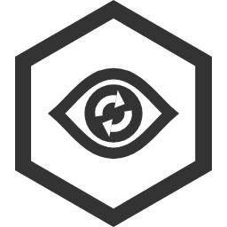

# syncwatch icon



## What it shows

- **An eye**: syncwatch monitors the Syncthing servers, and it only looks. It never changes them.
- **2 sync arrows in the iris**: what it monitors is Syncthing, which keeps the servers and the PCs synchronized.
- **The IVAR hexagon** around it, with the same proportions, frame weight and ink as the other tools of IVAR Studios (Ingest, Photo Culler, md-writer, SMP).

The icon is black and white on purpose, the same as the others. Thus it prints, works as a favicon and stays readable on light and dark backgrounds. The white inside the hexagon keeps it readable on a dark header or taskbar.

## Files

| File | Use |
|---|---|
| `syncwatch-icon.svg` | The master drawing. Change this file. The tool builds all other files from it. |
| `png/syncwatch-icon-<size>.png` | Square, transparent around the hexagon: 16, 24, 32, 48, 64, 128, 256, 512 and 1024 px. |
| `syncwatch-icon.ico` | Windows icon (16 to 256 px in one file), for a shortcut to the dashboard or the binary. |
| `export.go` | Builds the PNGs and the `.ico` from the SVG and copies the files of the dashboard. |

The PNGs are square with the hexagon centered and as tall as the square (the hexagon is 0.866 times as wide as it is tall). Thus they fit each slot for a square icon.

The dashboard uses copies in `internal/web/assets/` (the SVG, the `.ico`, and the 32 and 256 px PNGs). The binary embeds them.

## Use of the icon

**Dashboard.** `layout.html` links the SVG as the favicon, the 32 px PNG as the alternative and the 256 px PNG as the `apple-touch-icon`. `/favicon.ico` serves the `.ico` for browsers that ask for it directly. The header shows the SVG next to the name.

**Discord.** Webhook messages have no avatar of their own, thus they show the avatar of the webhook. Give the webhook the icon in Discord: Channel → Integrations → Webhooks → the syncwatch webhook → upload `png/syncwatch-icon-256.png`.

**Other uses** (README, documents, slides): use a PNG of the size that you need, or the SVG.

## Drawing

All sizes are in the units of the SVG: `viewBox="0 0 173.2 200"`. Angles are clockwise from 12 o'clock.

| Part | Specification |
|---|---|
| Hexagon | The same as the other IVAR tools: regular, with a corner at the top and at the bottom. Circumradius 100 (173.2 wide and 200 tall), frame 14.1 thick. |
| Colors | Ink `#333333` and white `#ffffff`. No other color. |
| Eye | An almond shape, drawn as an ink line 10 thick with mitered corners, white inside. Its center line goes from (36.6, 100) to (136.6, 100) and reaches 35 above and below the middle. Each quarter is one cubic Bézier that starts at the corner at 40° and arrives level at the top or the bottom. The outside is approximately 116 by 80. |
| Iris | A solid ink circle, radius 25.5, in the middle of the hexagon (86.6, 100). A white gap of 4.5 separates it from the lids (the same gap as between the cards of Photo Culler). |
| Arrows | 2 white arcs, radius 13 and 6.5 thick, each 110° long, clockwise. Each ends in a triangular head 16 wide. The tip of the head is on the arc 40° further on. The first arc starts at 260°, the second 180° later. Thus 30° separate a tip from the next tail. |
| Position | The eye is in the center of the hexagon. |

## Build of the PNGs and the .ico

After a change of `syncwatch-icon.svg`, run from the root of the repository:

```sh
go run docs/icon/export.go              # finds Edge, Chrome or Chromium
go run docs/icon/export.go -browser PATH
```

The tool renders each PNG with the headless browser on a transparent background. It packs the 16 to 256 px PNGs into the `.ico` (PNG-compressed entries, which Windows reads from Vista on). It copies the 4 files of the dashboard into `internal/web/assets/`. Commit the results with the SVG.

## Rules for changes

- **Keep the hexagon exactly as it is.** It is the shared IVAR frame. Only the drawing inside changes between tools.
- **Keep the icon in 2 colors.** For a light version on a dark background, exchange ink and white completely. Do not tint parts of it.
- **Small sizes:** below 32 px the arrows merge into the iris, and the eye looks as an eye with a dark pupil. That is correct. Do not add detail for the small sizes.
